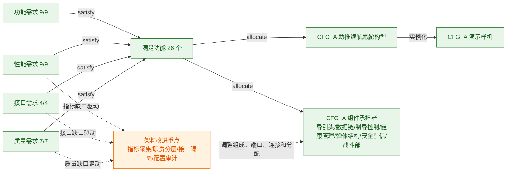

# CFG_A 最优架构方案需求覆盖与追溯分析报告

> 结论：29 条叶子需求均已建立功能满足关系，且对应功能均分配到 CFG_A 系统或其组成组件，需求追溯覆盖率为 100%。现有数据中，CFG_A 最大制导加速度为 232 m/s²，相对 250 m/s² 上限具有 7.2% 裕度；初筛综合评分为 0.971，相对 0.50 门槛高 94.1%。其余关键指标缺少同名、同单位的实际结果，不能虚构偏差；本报告针对这些缺口提出结构、接口和功能分配层面的架构修改建议。

## 1. 分析基线

- 最优方案：CFG-A，综合评分 `0.971`。
- 构型块：`车载防空导弹需求模型.架构模型.构型方案.CFG_A助推续航尾舵构型`。
- 架构实例：`车载防空导弹需求模型.架构模型.架构实例.CFG_A演示样机`。
- SysBuilder 视图：`CFG_A需求覆盖图`、`需求功能覆盖矩阵`、`CFG_A架构功能追溯矩阵`、`需求覆盖表`、`CFG_A架构表`。
- 数据来源：当前已打开模型的实时语义树、功能建模脚本中的 satisfy 映射、架构建模脚本中的 allocate 映射及架构权衡结果。
- 数据约束：模型未定义发动机比冲需求值或 CFG_A 比冲实际值，因此不形成比冲偏差或推进参数调整结论。

## 2. 需求覆盖图

## 3. 覆盖率摘要

| 审计层级 | 已覆盖/总数 | 覆盖率 | 判定 |
|---|---:|---:|---|
| 叶子需求 → 功能（satisfy） | 29/29 | 100.0% | 通过 |
| 满足功能 → CFG_A 结构（allocate） | 29/29 | 100.0% | 通过 |
| 需求 → 验证证据（verify/参数计算/测试结果） | 0/29 | 0.0% | 证据不足 |

需求分类：功能需求 9 条、性能需求 9 条、集成接口需求 4 条、通用质量特性需求 7 条。

## 4. 逐需求追溯矩阵

| 类别 | 需求 ID | 需求 | 满足功能 | CFG_A 承担结构 | 追溯状态 | 指标偏差/数据缺口 | 架构修改建议 |
|---|---|---|---|---|---|---|---|
| 性能需求 | `PERF-SAM-001/002` | PERF-SAM-001-002-探测与航迹稳定能力 | 探测目标并生成航迹 | 主动雷达导引头、导航数据链 | 已覆盖 | 当前架构实例未提供与该需求指标同名、同单位的结果值，偏差无法计算。 | 为导引头与数据链增加探测/航迹质量状态端口，将目标数、作用距离和可信度以只读项目流送入任务评估接口。 |
| 性能需求 | `PERF-SAM-005` | PERF-SAM-005-单弹机动能力 | 校验单弹机动边界 | 弹体结构组件 | 已覆盖 | 当前架构实例未提供与该需求指标同名、同单位的结果值，偏差无法计算。 | 在弹体结构组件旁路增加机动边界监测接口，将 accelerationNorm 与 maxOverload 只读送入健康管理单元。 |
| 性能需求 | `PERF-SAM-006` | PERF-SAM-006-单弹制导控制性能 | 执行智能制导控制 | 制导控制计算机 | 已覆盖 | CFG_A 最大制导加速度值属性为 232 m/s²，对比上限 250 m/s²，低于上限 18 m/s²（裕度 7.2%），该项不构成短板；guidanceCommandChatter 实际值缺失，无法计算抖动偏差。 | 在制导控制计算机与气动控制组件之间增加只读指令质量监测端口，并把 guidanceCommandChatter 与 controlOk 汇入健康管理单元；保留现有控制链。 |
| 性能需求 | `PERF-SAM-007` | PERF-SAM-007-气动结构承载能力 | 监测气动结构边界 | 弹体结构组件、健康管理单元 | 已覆盖 | 当前架构实例未提供与该需求指标同名、同单位的结果值，偏差无法计算。 | 在弹体结构组件中增加载荷监测子块，在气动控制组件中增加动压状态端口，统一向健康管理单元发布 mach、qDyn 和 structureLoadRatio。 |
| 性能需求 | `PERF-SAM-008` | PERF-SAM-008-单弹拦截效果 | 评估单弹拦截效果 | 安全引信组件、战斗部组件 | 已覆盖 | 需求为 minMissDistance≤80 m，CFG_A 未提供该实际值，偏差无法计算。 | 在弹上结构之外新增仿真结果标准化适配器，统一输出 minMissDistance、hitRadiusDemo 和结果有效标志；缺值时禁止默认通过。 |
| 性能需求 | `PERF-SAM-010` | PERF-SAM-010-多弹拦截效果 | 评估任务级拦截结果 | 健康管理单元 | 已覆盖 | 当前架构实例未提供与该需求指标同名、同单位的结果值，偏差无法计算。 | 将任务级拦截评估从健康管理单元移至外部任务评估组件，健康管理单元只提供状态数据。 |
| 功能需求 | `REQ-SAM-CONTROL-OPT-001` | REQ-SAM-CONTROL-OPT-001-控制参数优化能力 | 优化制导控制参数 | 制导控制计算机 | 已覆盖 | 缺少批量扫描输出、参数版本和 bestConfigId 回归结果，无法计算优化前后偏差。 | 把参数优化划入离线工程支持系统，新增配置基线与审计组件，仅向制导控制计算机发布经批准且可回滚的版本化参数。 |
| 功能需求 | `REQ-SAM-FUN-001` | REQ-SAM-FUN-001-海岛任务验证能力 | 执行车载防空导弹任务 | CFG_A助推续航尾舵构型 | 已覆盖 | 当前架构实例未提供与该需求指标同名、同单位的结果值，偏差无法计算。 | 当前未发现需要改变物理拓扑的数值短板；保留现有结构分配，并在承担块上补齐可观测值属性、类型化端口和健康状态项目流。 |
| 功能需求 | `REQ-SAM-FUN-002` | REQ-SAM-FUN-002-海岛环境建模能力 | 建立海岛环境 | 导航数据链 | 已覆盖 | 当前架构实例未提供与该需求指标同名、同单位的结果值，偏差无法计算。 | 将海岛环境建模从导航数据链重新分配到外部任务环境模型，导航数据链只保留环境数据接收接口。 |
| 功能需求 | `REQ-SAM-FUN-003` | REQ-SAM-FUN-003-单弹装备开发能力 | 开发单弹装备模型 | 弹体结构组件 | 已覆盖 | 当前架构实例未提供与该需求指标同名、同单位的结果值，偏差无法计算。 | 将单弹装备模型开发从弹体结构组件重新分配到工程模型管理组件，弹体结构组件仅承担结构状态与参数。 |
| 功能需求 | `REQ-SAM-FUN-004` | REQ-SAM-FUN-004-四构型开发能力 | 执行构型开发与筛选 | CFG_A助推续航尾舵构型 | 已覆盖 | 当前架构实例未提供与该需求指标同名、同单位的结果值，偏差无法计算。 | 当前未发现需要改变物理拓扑的数值短板；保留现有结构分配，并在承担块上补齐可观测值属性、类型化端口和健康状态项目流。 |
| 功能需求 | `REQ-SAM-FUN-005` | REQ-SAM-FUN-005-智能制导控制能力 | 执行智能制导控制 | 制导控制计算机 | 已覆盖 | 当前架构实例未提供与该需求指标同名、同单位的结果值，偏差无法计算。 | 当前未发现需要改变物理拓扑的数值短板；保留现有结构分配，并在承担块上补齐可观测值属性、类型化端口和健康状态项目流。 |
| 功能需求 | `REQ-SAM-FUN-006` | REQ-SAM-FUN-006-单弹标准工况验证能力 | 验证单弹标准工况 | 健康管理单元 | 已覆盖 | 当前架构实例未提供与该需求指标同名、同单位的结果值，偏差无法计算。 | 新增外部标准工况执行器，经测试接口连接 CFG_A；健康管理单元仅上报健康状态，不承担工况生成。 |
| 功能需求 | `REQ-SAM-FUN-009` | REQ-SAM-FUN-009-任务级回接验证能力 | 回接任务级应用场景 | 导航数据链 | 已覆盖 | 当前架构实例未提供与该需求指标同名、同单位的结果值，偏差无法计算。 | 在任务场景与导航数据链之间增加任务集成适配器，隔离任务级数据模型与弹上接口模型。 |
| 集成接口需求 | `REQ-SAM-IF-001` | REQ-SAM-IF-001-单弹标准总线接口 | 交换标准总线数据 | 导航数据链 | 已覆盖 | 当前架构实例未提供与该需求指标同名、同单位的结果值，偏差无法计算。 | 在导航数据链外侧增加标准总线网关，定义版本化接口块、数据校验和异常状态端口。 |
| 集成接口需求 | `REQ-SAM-IF-002` | REQ-SAM-IF-002-阶段结果门控接口 | 校验阶段A结果 | 健康管理单元 | 已覆盖 | 当前架构实例未提供与该需求指标同名、同单位的结果值，偏差无法计算。 | 在健康管理单元前增加阶段结果门控组件，对缺失、越界或版本不一致的数据采用失败关闭。 |
| 集成接口需求 | `REQ-SAM-IF-003` | REQ-SAM-IF-003-场景数组维度接口 | 管理场景数组接口 | 导航数据链 | 已覆盖 | 当前架构实例未提供与该需求指标同名、同单位的结果值，偏差无法计算。 | 新增场景数组适配器，负责维度、索引和单位校验后再向导航数据链发布。 |
| 集成接口需求 | `REQ-SAM-IF-004` | REQ-SAM-IF-004-外部预留只读接口 | 发布外部只读状态 | 导航数据链 | 已覆盖 | 当前架构实例未提供与该需求指标同名、同单位的结果值，偏差无法计算。 | 设置独立只读发布网关，将外部预留接口与内部控制总线隔离，并保留访问审计。 |
| 功能需求 | `REQ-SAM-PARAM-DEVIATION-001` | REQ-SAM-PARAM-DEVIATION-001-参数拉偏试验能力 | 开展关键参数拉偏试验 | 健康管理单元 | 已覆盖 | 拉偏范围、步长和结果值均未固化，无法计算边界偏差。 | 新增离线试验配置与边界管理组件，承载范围、步长、终止条件和异常保护；通过隔离接口驱动拉偏，不并入弹上实时链。 |
| 性能需求 | `REQ-SAM-PERF-011` | REQ-SAM-PERF-011-任务时序与边界 | 配置任务时序 | 制导控制计算机 | 已覆盖 | 当前架构实例未提供与该需求指标同名、同单位的结果值，偏差无法计算。 | 当前未发现需要改变物理拓扑的数值短板；保留现有结构分配，并在承担块上补齐可观测值属性、类型化端口和健康状态项目流。 |
| 性能需求 | `REQ-SAM-PERF-012` | REQ-SAM-PERF-012-阶段A标准工况参数 | 验证单弹标准工况 | 健康管理单元 | 已覆盖 | 当前架构实例未提供与该需求指标同名、同单位的结果值，偏差无法计算。 | 当前未发现需要改变物理拓扑的数值短板；保留现有结构分配，并在承担块上补齐可观测值属性、类型化端口和健康状态项目流。 |
| 通用质量特性需求 | `REQ-SAM-QUAL-001` | REQ-SAM-QUAL-001-演示模型适用边界 | 标识演示模型边界 | 健康管理单元 | 已覆盖 | 当前架构实例未提供与该需求指标同名、同单位的结果值，偏差无法计算。 | 当前未发现需要改变物理拓扑的数值短板；保留现有结构分配，并在承担块上补齐可观测值属性、类型化端口和健康状态项目流。 |
| 通用质量特性需求 | `REQ-SAM-QUAL-002` | REQ-SAM-QUAL-002-单位与库基线一致性 | 维护模型单位基线 | 弹体结构组件 | 已覆盖 | 当前架构实例未提供与该需求指标同名、同单位的结果值，偏差无法计算。 | 新增单位与数据字典块，为接口项和值属性统一类型、量纲与版本。 |
| 通用质量特性需求 | `REQ-SAM-QUAL-003` | REQ-SAM-QUAL-003-确定性离线仿真 | 执行确定性离线仿真 | 制导控制计算机 | 已覆盖 | 当前架构实例未提供与该需求指标同名、同单位的结果值，偏差无法计算。 | 在工程支持系统中新增确定性仿真执行控制器，固化时间步长、随机种子和模型版本。 |
| 通用质量特性需求 | `REQ-SAM-QUAL-004` | REQ-SAM-QUAL-004-数值安全与异常可见性 | 检测数值异常 | 健康管理单元 | 已覆盖 | 当前架构实例未提供与该需求指标同名、同单位的结果值，偏差无法计算。 | 将数值异常监测与隔离细化为健康管理单元的子块，汇聚 noNaNInf 与各组件故障状态。 |
| 通用质量特性需求 | `REQ-SAM-QUAL-005` | REQ-SAM-QUAL-005-验证证据与复现性 | 归档验证证据 | 导航数据链 | 已覆盖 | 当前架构实例未提供与该需求指标同名、同单位的结果值，偏差无法计算。 | 新增验证证据记录组件，以只读方式接收配置、输入摘要、输出摘要和通过状态。 |
| 通用质量特性需求 | `REQ-SAM-QUAL-006` | REQ-SAM-QUAL-006-命中半径口径一致性 | 统一命中判定口径 | 安全引信组件 | 已覆盖 | 当前架构实例未提供与该需求指标同名、同单位的结果值，偏差无法计算。 | 新增判定口径配置块，集中管理 hitRadiusDemo 等口径，避免在多个组件中重复定义。 |
| 通用质量特性需求 | `REQ-SAM-QUAL-007` | REQ-SAM-QUAL-007-优化与拉偏配置受控 | 管理优化拉偏配置 | 制导控制计算机 | 已覆盖 | 当前架构实例未提供与该需求指标同名、同单位的结果值，偏差无法计算。 | 由配置基线与审计组件统一管理优化、拉偏和回滚配置，运行结构只读取已批准基线。 |
| 性能需求 | `SEL-SAM-003` | SEL-SAM-003-最佳构型唯一性 | 执行构型开发与筛选 | CFG_A助推续航尾舵构型 | 已覆盖 | CFG_A 初筛综合评分为 0.971，高于 0.50 门槛 0.471（相对高 94.1%）；但严格 gatePass 所需仿真指标缺失。 | 在工程支持系统中新增构型权衡与门槛判定组件，通过标准化结果接口读取四构型数据；CFG_A 仅作为被评估实例，不在弹上运行链中承担筛选。 |

## 5. 指标偏差与架构缺口结论

### 5.1 可计算的指标偏差

1. **最大制导加速度满足当前上限。** CFG_A 架构实例值为 `232 m/s²`，需求上限为 `250 m/s²`，低于上限 `18 m/s²`，裕度为 `7.2%`；当前没有依据建议增大该参数。
2. **初筛综合评分高于演示门槛。** CFG_A 综合评分为 `0.971`，相对 `0.50` 门槛高 `0.471`，即高 `94.1%`；但该结果是架构初筛，不等同于严格 gatePass。
3. **未发现可以证明‘实际值低于需求值若干百分比’的性能项。** `minMissDistance`、`guidanceCommandChatter`、最大过载、动压、结构载荷利用率和任务级结果均缺少 CFG_A 实际输出，因此不能虚构偏差比例。
4. **模型没有发动机比冲字段。** 当前只有最大推力、推进工作时间、质量等演示参数，不能形成‘比冲低于需求 5.2%’或调整燃料配比、燃烧室压力的结论。

### 5.2 由数据缺口暴露出的架构问题

1. **指标采集链不完整。** 现有 IBD 已连接制导、气动、结构和健康状态，但未把需求指标作为类型化、可观测项目流统一汇入健康管理与外部评估接口。
2. **弹上运行结构与离线工程功能混分配。** 环境建模、构型筛选、参数优化、拉偏试验和任务级评估被分配到导航数据链、制导控制计算机或健康管理单元，职责边界不清。
3. **外部接口边界未独立。** 标准总线、场景数组和只读发布均主要由导航数据链承担，缺少协议适配、数据校验和只读隔离层。
4. **配置发布缺少独立架构责任。** 优化参数、拉偏配置、版本审计和回滚尚未由独立组件承担。
5. **仿真结果缺少统一适配层。** 不同构型输出未通过统一接口形成 `minMissDistance`、`guidanceCommandChatter`、`gatePass` 等同口径数据。

## 6. CFG_A 架构修改建议

### 6.1 建议新增或细化的模块

| 优先级 | 架构修改 | 模型落点 | 主要驱动需求 |
|---|---|---|---|
| P0 | 新增`指标采集与健康监测适配组件`，旁路采集制导、气动、结构和动力指标 | CFG_A BDD 组成块；CFG_A IBD 端口与连接器 | PERF-SAM-005/006/007、REQ-SAM-QUAL-004 |
| P0 | 新增`仿真结果标准化适配器`与`构型权衡及门槛判定组件` | 工程支持系统 BDD；与 CFG_A 建立引用关系 | PERF-SAM-008、SEL-SAM-003、PERF-SAM-010 |
| P1 | 新增`配置基线与审计组件`、弹上`配置接收与校验组件` | 工程支持系统与 CFG_A 的 BDD/IBD | REQ-SAM-CONTROL-OPT-001、REQ-SAM-PARAM-DEVIATION-001、REQ-SAM-QUAL-007 |
| P1 | 新增`标准总线网关`、`场景数组适配器`和`只读状态发布网关` | 接口模型与 CFG_A IBD | REQ-SAM-IF-001/003/004 |
| P1 | 新增`阶段结果门控组件`，异常或缺值时失败关闭 | 工程支持系统至 CFG_A 的集成边界 | REQ-SAM-IF-002 |
| P2 | 新增`单位与数据字典块`、`验证证据记录组件` | 接口模型与工程支持系统 | REQ-SAM-QUAL-002/005/006 |

### 6.2 BDD 结构调整

- 在 CFG_A 的组成结构中增加 `指标采集与健康监测适配组件`、`配置接收与校验组件`、`标准总线网关`和`只读状态发布网关`。
- 在 CFG_A 外部建立 `工程支持系统`，组成 `任务环境模型`、`工程模型管理组件`、`标准工况执行器`、`离线优化与拉偏组件`、`仿真结果标准化适配器`、`构型权衡及门槛判定组件`、`配置基线与审计组件`和`验证证据记录组件`。
- CFG_A 与工程支持系统之间使用引用关系和类型化接口连接，避免把离线设计、筛选和试验工具建成弹上物理组成。
- 保留 CFG_A 现有导引头、数据链、制导控制、健康管理、弹体结构、气动控制、动力、安全引信和战斗部物理拓扑；当前数值没有支持更换动力或气动拓扑的证据。

### 6.3 IBD 连接调整

- 保留`制导控制部件.导引指令输出 → 气动控制部件.制导指令输入`主连接，同时以只读旁路把指令送至指标采集组件，输出 `guidanceCommandChatter` 和 `controlOk` 至健康管理单元。
- 将气动、弹体结构和动力状态端口同时接入指标采集组件，形成 `mach`、`qDyn`、`structureLoadRatio`、`accelerationNorm` 和 `maxOverload` 项目流。
- 将外部标准总线先接入标准总线网关，再进入导航数据链；将导航与健康状态经只读发布网关输出，隔离内部控制接口。
- 将配置基线与审计组件的批准配置接入弹上配置接收与校验组件，再发布给制导控制计算机；校验失败保持上一有效版本并上报健康状态。
- 将统一仿真输出接入仿真结果标准化适配器，再送构型权衡及门槛判定组件；任何必需指标缺失时输出结果无效，不得默认通过。

### 6.4 功能重新分配

| 功能 | 当前承担者 | 建议承担者 | 调整目的 |
|---|---|---|---|
| 建立海岛环境 | 导航数据链 | 外部任务环境模型 | 将场景生成与弹上通信解耦 |
| 开发单弹装备模型 | 弹体结构组件 | 工程模型管理组件 | 区分模型开发与物理结构责任 |
| 执行构型开发与筛选 | CFG_A 构型块 | 构型权衡及门槛判定组件 | 避免被评估对象承担自身筛选 |
| 验证单弹标准工况 | 健康管理单元 | 外部标准工况执行器；健康管理单元仅上报状态 | 分离试验执行与健康监测 |
| 优化制导控制参数 | 制导控制计算机 | 离线优化与拉偏组件；配置基线与审计组件 | 防止运行结构直接改写设计参数 |
| 开展关键参数拉偏试验 | 健康管理单元 | 离线优化与拉偏组件 | 将试验配置移出弹上实时链 |
| 评估任务级拦截结果 | 健康管理单元 | 外部任务评估组件 | 避免健康管理承担任务判定 |

### 6.5 修改后的判定口径

- 对有实际值的指标使用`(实际值-需求值)/需求值`或相应上限裕度计算偏差，并标明方向。
- 对实际值缺失的指标写明`无法计算偏差`，先通过新增端口、项目流和承担组件补齐数据链，不直接给出性能参数调优结论。
- 架构修改完成后更新 BDD、CFG_A IBD、架构功能追溯矩阵以及相关 allocate 关系，确保功能责任与结构边界一致。

## 7. 分析限制

SysBuilder 语义 JSON 当前不直接暴露 satisfy/allocate 关系边；本报告以当前模型元素存在性为基础，并使用已执行的功能建模与架构建模脚本中的关系映射复核覆盖。模型内新建的两个追溯矩阵是后续人工审查关系边的主视图。当前权衡结果明确属于演示参数驱动的架构初筛，缺少统一仿真输出时不得把数据缺口解释为性能不达标，也不得虚构偏差百分比。

---

语义元素统计：Requirement 34、Action 83、Block 17、Part Property 84、Relation MatrixDiagram 2。
